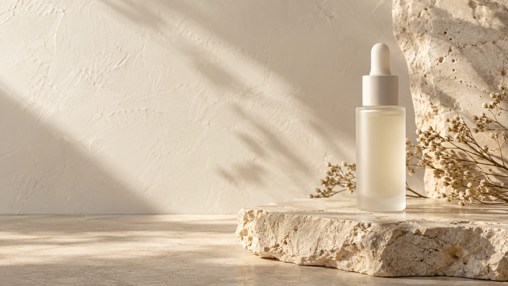

# REVIVE — Shopify Product Page Concept

A minimal, responsive Shopify product-page concept for a fictional skincare brand. This is a **portfolio project**, not a live product or a claim about clinical performance.

## What I built

- An Online Store 2.0 product section in Liquid, with editable copy and image settings.
- A matching JSON product template that can be assigned to a test product.
- A responsive editorial layout with original concept imagery, clear product information and a Shopify variant/cart form when a product is assigned.
- A rebuilt [browser preview](preview/index.html) for reviewing the visual design without a Shopify store.

The work reflects my focus on clean landing pages, mobile layouts and Shopify theme customization. AI-assisted tools helped with image creation and implementation; the concept, layout, editing and integration were reviewed as a portfolio exercise.

## Preview locally

From this repository's root, run `python -m http.server 8765` and open `http://localhost:8765/preview/`. The preview is visual only; Shopify pricing, inventory and cart actions require a Shopify product template.

## Upload as an unpublished Shopify theme

Run `shopify theme package` from the repository root. Upload the resulting ZIP in Shopify Admin → Online Store → Themes → Add theme → Upload zip file. The theme includes a home page, product page, cart and 404 page. Keep it unpublished while reviewing the concept.

## Add to an existing unpublished theme

1. Copy `assets/concept-page.css`, the three `assets/revive-*.png` images, `sections/revive-concept-product.liquid`, and `templates/product.revive-concept.json` to the same paths in the theme.
2. In Shopify Admin, assign the `revive-concept` template to a **test product**.
3. Open the unpublished theme editor. Edit the section copy and optionally select replacement images through its image settings.
4. Preview desktop and mobile layouts. Check variant prices, inventory, cart behavior and all product copy before using the page for a real product.

The concept imagery contains generic packaging. Replace it with approved product photography before any commercial launch. No fabricated reviews, ingredient claims or clinical results are included in the Liquid page.

## Files

| Path | Purpose |
| --- | --- |
| `sections/revive-concept-product.liquid` | Shopify section and product form |
| `templates/product.revive-concept.json` | Online Store 2.0 product template |
| `assets/concept-page.css` | Responsive visual system |
| `assets/revive-hero.jpg`, `assets/revive-detail.jpg`, `assets/revive-product.jpg` | AI-generated concept imagery |
| `preview/index.html` | Standalone visual preview |
| `layout/theme.liquid`, `templates/`, `config/`, `locales/` | Minimal uploadable Shopify theme structure |
| `src/` | Rebuilt React/Vite design preview; the Shopify Liquid files remain the deployable theme deliverable |

## Concept image prompts

- Hero: generic frosted ivory serum bottle on limestone, warm plaster, soft morning light, negative space, no text or logo.
- Detail: serum droplets, ivory linen and pale stone in warm window light, no packaging or claims.
- Product: generic frosted ivory serum bottle on limestone, soft studio light, no label or claims.

The images were created with the built-in image generation tool and saved in `assets/` for this project.

## Rebuilt frontend preview

Run `npm install` and `npm run dev` to view the redesigned responsive React concept. This preview is separate from the Shopify Liquid theme and contains no simulated checkout or unverified customer and health claims. Run `npm run lint` and `npm run build` to verify it.
